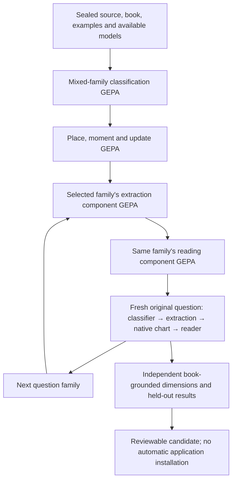
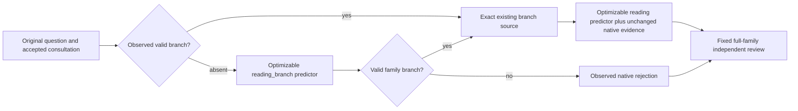
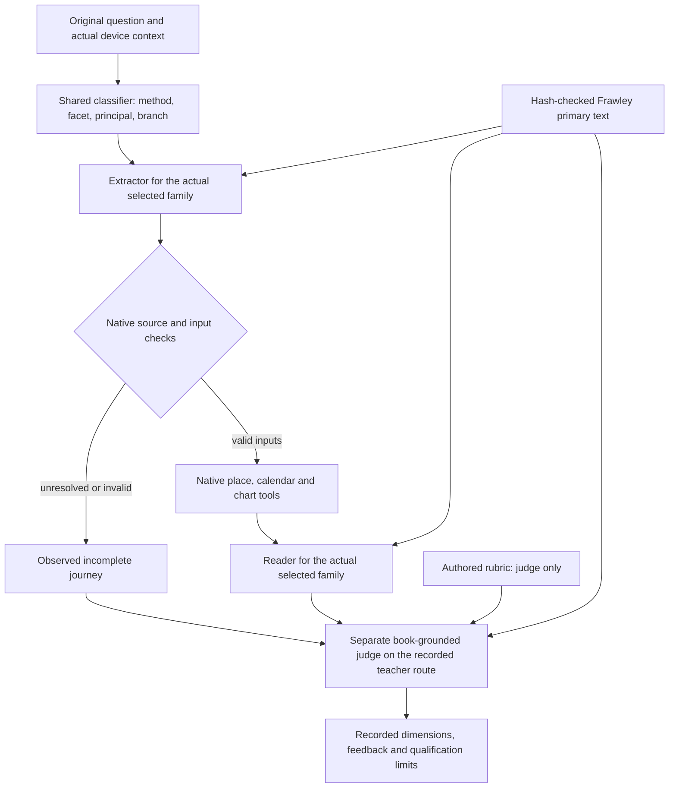

# Horary DSPy experiment

For Eileen's review, [full questions and saved worked answers](review/README.md)
are published separately from their rubrics, with exact coverage and missing
answers listed. These are generated reference readings, not qualified application
outputs.

`--teacher codex generate-gold-readings --prepare-only --output /fresh/plan`
binds all 42 original twenty-case banks, their unchanged splits, actual native
inputs, complete salient primary teacher source, executable and shared 3360-call
author/reviewer cap. Execute once with `--prepared /fresh/plan --output /fresh/answers`.
Contact, NewJob, MovableDeal and Relationship come first, then the remaining
families. Every case saves an actual five-field worked answer separately from
its rubric and source/review metadata. A useful qualified answer with genuine
calculation limits can pass; only source-correct reading and answer dimensions
apply. One received failure may receive one new corrective answer and independent
review. Uncertain work is never replayed; failed cases remain preserved while
distinct cases continue. Student demonstrations contain only declared inputs and
status/answer/analysis/evidence/unresolved, never rubric prose or provenance.
Author/reviewer primary context and compact student inputs have separate hashes.
This phase performs no student inference or application promotion.

`--teacher codex optimize-gold-readings --gold-campaign /author/campaign
--approval-gate /source-approved-first-three.json --watch --output /fresh/compile`
uses those actual answers with the existing stock LabeledFewShot and GEPA path.
It waits for each family's twenty approvals, keeps the original 12/4/4 split,
and selects two TRAIN worked examples. Exact ordinary provider token counts
include both demonstrations and the 8192-token output allowance before generation.
The independent judge receives full primary context, an actual reference answer,
and criteria in distinct fields; development/test references never become demos
or reflection inputs. Stock Evaluate separately measures the authored no-demo,
labeled, and selected programs. The sequential 42-family pass carries cumulative
physical counts and one adaptive Google limiter, bounded to 64 student and 80
Codex calls per family with 24 soft GEPA metric calls. Missing/failed families
remain recorded, uncertain keys are not retried, and other independent families
continue. Reading-component results do not establish a first-message extraction
journey or install a prompt into the application.

The same gold consumer accepts the existing `--student-local-url` and
`--student-model` flags. It uses the port's resident provider with a finite
600-second reading timeout and exact resident chat-template/tokenizer counts
before generation, without loading a Google credential or applying Google
rate pacing. The resident slot's reported context must fit the two unchanged
worked examples plus 8192 output tokens. `--prior-consumer-closure` binds a
deliberately stopped, fully received no-answer hosted comparison and deducts
its two physical quota rejections from the first family's original cap. The
local model starts a distinct authored/labeled/selected baseline; no hosted
answer, semantic score or optimizer state is imported.

`--concise-student --prepare-student-only --method contact` creates a fresh
student presentation: a short source-grounded procedure, compact method-relevant
native facts and originally supplied motion, and one actual
TRAIN worked answer of at most 250 words. The teacher derives and independently
reviews that answer using the full canonical chart, approved reference and book;
the original gold remains intact. Exact token counts cover all twenty original
cases first without a demo and then with the demo. Preparation submits no student
generation. Reuse the approved label with `--prepared-student /preparation/run`;
its completed teacher carriers and all physical deductions remain bound to the
same source, input and original caps. The prior unsettled review remains blocked.

Every concise student request, including a later GEPA rewrite, must pass an
exact whole-wire 6000-input-token ceiling before a physical reservation. Output
allows 2048 tokens. Live charts select evidence from declared consultation roles,
their conditions, directed receptions and relevant ordered events; they do not
use private expected answers. Both live input and the worked example use compact
text without provenance metadata. The saved example additionally retains every
fact cited by its approved answer. Explicit omission limits preserve uncertainty;
the full original chart and actor aliases remain in the private record. The
independent judge keeps full canonical inputs and primary source. This is a new
declared component baseline, with no comparison against the stopped large-input
runs. Contact is the first supported concise procedure; later families require
their own source-grounded procedure under the same presentation contract.

`evaluate-reception --prepare-only` renders the actual short Predict requests for
four original Contact training probes without calling a model. The reusable
function accepts an `AcceptedReceptionRole`-shaped actor clipboard and one exact
native `DirectedReception`, with printed pp. 44/71–73. Its native edge/role/quality
checks cannot be compensated by a fluent review; Codex grades only qualified
contextual meaning. `evaluate-reception --prepared <directory>` performs stock
Evaluate sequentially, bounded to four local student calls and eight teacher
attempts. It runs no bootstrap, reflection or selection and makes no full-reading
or application qualification claim. Multiple native roles sharing a planet remain
explicit; production integration can batch edges in the existing reception stage.

This crate uses the full [getlatentic/dsrust](https://github.com/getlatentic/dsrust/tree/f24adde08c1d8850e4d7079d019643bb40f905cb) API directly. The repository-contained licensed [snapshot](vendor/dsrust) is `09d17e07e18e9db2d12e33e2a4a29ca639da65de`, a narrow fork of that revision. It retains the original 20-second default and permits a 300-second local nonstreaming call. It also carries exact received replies when the existing parser rejects them, allowing a format-failure metric without confusing missing transport with bad output. [Provenance](vendor/dsrust/HORARY-PROVENANCE.json) records both changes; provider wire formats, parsing decisions and optimizer algorithms remain the existing port. Rust derives the neural signatures; the port owns prompt rendering, parsing, demonstrations, evaluation and optimization. The local code supplies the Horary module, source context, provider transport and grading. It does not implement a replacement GEPA engine.

## Resident local student

Reader exchanges put the unchanged primary text before the live question, consultation and chart evidence. The stock ChatAdapter preserves that order, allowing the resident server to reuse a book prefix across cases while keeping current facts at the end. This changes only future source-bound runs; existing compiled snapshots remain immutable. Cache layout is verified, but a latency gain is not yet measured.

The global `--student-local-url http://127.0.0.1:63924/v1` flag selects the existing port's OpenAI-compatible provider for `run`, `optimize`, `optimize-classification`, `compare-classification` and `optimize-reading`. `--student-model` records the actual server model identity (default `gemma-4-12b-it-qat-mtp`). The teacher and primary-text inputs remain unchanged. Local calls use a separate uncredentialed HTTP client, ordinary unconstrained text, no Google pacing, no hidden response cache or automatic retry, and preserved request/result receipts. A local transport failure stops later submissions. Physical-call caps are shared across all predictors using that student. This selector does not change or execute any sealed hosted queue.

`optimize-reading --method contact --output /fresh/run` is one bounded reader round; the default family remains `new_job`. Its original twenty fixtures retain their 12/4/4 split, independently supplied accepted consultation, actual device context and calculated chart. A single `Predict`, named `reading.<family>`, receives the union of the existing family and actual branch passage allocations, including their common primary pages; it has no neural selector or expected branch input. [The NewJob baseline](prompts/new_job_reader.md) adapts current native NewJob teaching to the component's five-field contract. Other families start with their existing typed reading instructions and that output contract; stock GEPA learns family teaching from book-equipped training feedback. The fixed metric requires both source-correct interpretation and a coherent answer, while classification and extraction remain unobserved. Defaults are 16 soft iteration-boundary metric evaluations, three-case training reflections, seed 23, zero demonstrations, 72 hard local submissions and 96 shared teacher attempts. Evaluate and GEPA execute one component at a time. The actual Gemini listing/sequence is preserved and exhausted before authorized saved-login Codex fallback. Development/test words are never reflection inputs. Its versioned artifact is explicitly a direct family reader and cannot enter the legacy two-predictor loader; native handoff, full journeys and installation remain separate gates. A family's complete source allocation still needs to fit the actual model context; declaring a signature does not qualify its execution or interpretation.

An explicitly authorized `--teacher codex optimize-reading` comparison uses the existing tool-free, saved-login teacher directly, with the same primary text and fixed criterion. It does not load a Google credential, list Google models or resubmit a failed Gemini request. The default remains the Gemini pool. A replacement run must record its closed predecessor and deduct prior physical attempts, including unknown teacher calls, from the explicitly supplied remaining caps; no optimizer score or incomplete provider work is imported.

`optimize-reading --method contact --bootstrap-only` first runs upstream BootstrapFewShot with a matched one-Predict teacher and student, one teacher-produced training demo, zero labeled gold demos, one round, a full-pass threshold and one execution-error limit. It never calls the student; its local cap is zero and its teacher cap is at most 24 physical attempts. Reading and answer-quality dimensions, native checks and review-summary consistency must all pass. Failed examples and raw reviews remain preserved. No fully correct teacher example means this phase stops without student evaluation. Contact teaching includes full printed pp.92–93 so both translation variants and collection are explicit. Full teacher inputs/output and the separate compact demonstration remain in `bootstrapped-full.json` and `bootstrapped.json`. `student-preflight.json` contains actual ChatAdapter messages for every original case, including the demo, without submitting generation. Check those messages plus the 4096-token generation allowance against the resident slot before continuing.

After independently checking the worked example and its token budget, pass `--bootstrap-program /absolute/path/to/bootstrapped.json` with a fresh output directory. It validates exact source, signature, original fixture/split digest, completed teacher-only result and the single demonstration, then starts ordinary GEPA without repurchasing the bootstrap or importing optimizer state. That phase's baseline is the authored instruction with the verified demonstration; it is not a comparison against a zero-shot baseline. Without either bootstrap flag the command remains instruction-only. One accepted example does not qualify application correctness.

Repeated `--training-case`, `--development-case` and `--test-case` arguments bound a classification round to exact existing IDs. All three pools are required when selecting; moving a case to another split or changing a label is forbidden. The short classifier has a 512-token output bound and explicit output-only guidance; source-grounded reader and judge limits remain unchanged. A fully received unparseable student reply earns a deterministic format-rejection score with its exact response and feedback; it creates no invented semantic fields or extra review call. Missing provider work still stops the run. `--bootstrap-demos 0` selects the pinned port's instruction-only GEPA compiler. The saved manifest records the exact selected cases and effective dependency identity. Component results still need actual native first-message checks before application promotion.

`compare-classification --method contact --candidate-instructions proposal.txt --output fresh-directory` runs the unchanged baseline and a previously source-reviewed instruction through the port's `Evaluate` on the complete original four-case family development pool. Only the instruction differs; declarations, original inputs, guards and independent grading remain fixed. There is no reflection, search, test-set reuse or deployment. The single resident student uses at most eight calls, and the shared normal teacher pool is bounded at 64 physical calls including unavailable routes. A tie remains a tie. The vendored subset excludes the unused upstream Python bridge; no Python source or runtime is required.

This is an experimental optimizer path. It has not been promoted into the production application. The default teacher policy is now `--teacher pool`: use the available listed Gemini text generation models in a deterministic sequence, preferring Gemini 3.8 Flash, and use the saved Codex login only after those eligible routes have known quota or availability failures. Each model has its own cache and pacing state; all teacher submissions share one physical-call cap. An uncertain response, authentication failure or completed bad semantic answer never triggers model substitution. Explicit `--teacher gemini` and `--teacher codex` remain available for controlled experiments. There is no qualified new application winner from this path.

## The complete conventional queue

`queue-plan` seals 130 queue tasks: 88 DSPy optimization runs (one mixed-family classifier, three auxiliary functions, 42 extractors and 42 readers), and 42 end-to-end checks. Each initial reading family has twenty cases, split 12/4/4. The independent judge is fixed. The queue calls the pinned port's GEPA compiler directly; it does not implement a second optimizer. This first queue optimizes instructions with zero bootstrap demonstrations, an explicit policy that avoids repeating the earlier bulky-bootstrap pilot. The optional older `optimize` command still supports the port's standard bootstrap path and preserves full teacher demonstrations.



The reading component receives an independently authored accepted consultation and a real native chart. It is labelled as a component, not successful elicitation. The journey gate instead acquires its own facts and calculates its own chart from the actual classifier and extractor outputs. Compiled components must match the queue's executable, teaching sources, exact fixture digest and canonical family bank. The queue rechecks source and fixture identity at each job boundary. Expected method, facts, chart seed and grading rubric never become journey inputs.

The standalone reading component is now the version-2 [ReadingProgram](src/reading.rs), with two optimizable port predictors: `reading_branch.<family>` and `reading.<family>`. When the accepted consultation already contains a valid branch, it calls only the reader. Otherwise its typed, ordinary-text selector receives the original question, accepted consultation and that family's source taxonomy. It selects an actual branch; it cannot borrow a grading label or page-coverage witness. The reader receives the exact existing `catalogue::branch_source` allocation for that branch, including common foundations and cross-chapter passages. Chart evidence and native unknowns pass through unchanged. A received unsupported branch is an observed native rejection, not a transport retry or a guessed route. The independent judge and GEPA feedback retain the complete family source context.

Both reading predictors are saved and source-validated together. Older one-predictor reading artifacts fail the versioned loader. A fresh Journey already owns its classifier's branch, so it validates the complete artifact and explicitly projects the reader, recording the bypassed selector's identity. This projection is source-qualified, not semantic qualification. The native exporter still accepts only a classified Journey's extractor/reader artifact; it rejects a standalone reading Module rather than silently discarding its selector. No candidate is installed automatically.



Function-local dimensions and native checks drive optimization. Inapplicable stages cannot veto a component. Raw independent-summary disagreements remain visible and withhold qualification; they are not rewritten as a win. A completed invalid fact array, unsupported route or invented native citation is an observed rejection with feedback. Missing/interrupted provider evidence remains unknown and stops further submissions. The port's fallback zero for an execution error cannot qualify a search result.

Classification also requires exact agreement with the independently authored method and facet labels. Those private targets never enter the student's inputs. A teacher's fluent positive review cannot override a known mismatch; its original score and reasons remain visible. Correct labels alone do not replace source-semantic review, and an absent review remains unknown. Existing paid results can be inspected or regraded without repurchasing them.

Classification validates method, method-specific facet and book branch before scoring. The allowed facets come from the same generated native contracts supplied to the classifier. A branch name in the facet field is an observed failure even when the independent judge returns a positive score; both raw outputs remain unchanged in the trace. Facet membership establishes format validity only, not whether a valid facet answers the actual question.

Google's listed input context limit is checked separately from input-token pacing. The configured rate is an initial hint, not a per-request length limit. The limiter probes higher throughput after successes up to a recorded ceiling, adopts actual provider quota hints on 429, and retains RetryInfo/Retry-After waits. One student client and limiter span the entire queue. Physical retries count against the same caps. Never restart a queue to bypass its durable guard or reset counters.

Quota dimensions normally match the exact requested model. The fixed `gemma-4-26b-a4b-it` student also accepts Google's observed `gemma-4-26b` quota group, with an optional `models/` prefix; a settled response reported 16,000 input tokens per minute under that identity. Other Gemma sizes and arbitrary prefixes do not match. Raw violations remain unchanged in the receipts. This transport correction does not retroactively change an immutable running worker or its recorded decisions.

From a built, copied executable, using absolute paths:

```sh
horary-dspy models --output /absolute/path/to/model-listing.json
horary-dspy preflight --examples /absolute/path/to/examples \
  --models /absolute/path/to/model-listing.json --output /absolute/path/to/preflight
horary-dspy queue-plan --examples /absolute/path/to/examples \
  --models /absolute/path/to/model-listing.json --output /absolute/path/to/queue
horary-dspy queue-execute --examples /absolute/path/to/examples \
  --plan /absolute/path/to/queue/queue-plan.json
horary-dspy queue-status --output /absolute/path/to/queue
```

Preflight formats every baseline exchange locally and counts the largest rendered exchange per function by default; `--all-counts` counts every exchange. For a standalone reading whose branch is unobserved, it enumerates the selector and all declared branch-reader alternatives without calling a model or pretending any branch was selected. The inventory distinguishes these alternatives from cases. Sampling and byte sizes do not prove every request's token admission. The actual transport counts every exact request before generation. These checks establish source and execution mechanics, not guaranteed semantic improvement. The plan records nominal function evaluations, up to two student functions per standalone reading, and hard physical caps. Until observed tokens, waits and latencies arrive, elapsed time is a conditional forecast rather than a promised completion time.

A closed queue with no completed jobs can carry its exact transport caches into a separately reviewed, fresh queue. `queue-continuation-inspect` performs no provider calls: it checks the parent closure receipt, exact owner/child PID absence, complete physical request/body/result identities, the full sealed carrier file sets and actual normalized response counts. Its manifest records reviewed operational source changes, unchanged original cases, splits, book, signatures, schemas and caps, and any changed reading rendering that needs a fresh baseline. The new queue imports carrier files only; it does not import grades, development traces, a partially compiled program or the old start guard. The ordinary pinned compiler runs again and exact settled calls replay through its adapters without repurchasing them. A witnessed unusable HTTP 200/MAX_TOKENS teacher output remains preserved and may use the separately bounded same-route format repair; uncertainty or an existing semantic judgment is not permission to retry.

An alternate closure may explicitly authorize one completed student transient HTTP failure. The receipt must name its exact logical key and request/failure hashes; every old attempt must have a complete 429/500/502/503/504 response, and there may be no raw, normalized or parsed model answer. At most three new physical attempts use a separate key bound to that closure and the unchanged request. The old request, failure and attempts remain byte-identical. The new ordinal span and all other calls count against the original cumulative cap; no unrelated fresh student call may consume this slot before activation. A new failed or uncertain slot cannot repeat. The teacher resumes from its last settled completed receipt and retains the complete prior route cache set. Zero/daily quota and semantic/format failures are not student recovery permissions.

Reviewed reading-v2 and export source deltas require exact before/after hashes in the closure, not prose approval. Static signatures, extraction/classification inputs, case banks, splits, book bytes, schemas and native calculations remain fixed. Reading input changes receive fresh baselines. Recursive predecessor receipts and their closed owners are checked before carriage.

Prepare the manifest with the final executable, then bind it to both new planning and execution:

```sh
horary-dspy queue-continuation-inspect --parent /absolute/path/to/closed-campaign \
  --closure-receipt /absolute/path/to/verified-closure.json \
  --examples /absolute/path/to/examples --review-note "Reviewed carrier and rendering changes" \
  > /absolute/path/to/continuation-manifest.json
horary-dspy queue-plan --examples /absolute/path/to/examples \
  --models /absolute/path/to/original-model-listing.json --output /absolute/path/to/new-queue \
  --continuation-manifest /absolute/path/to/continuation-manifest.json
horary-dspy queue-execute --examples /absolute/path/to/examples \
  --plan /absolute/path/to/new-queue/queue-plan.json \
  --continuation-manifest /absolute/path/to/continuation-manifest.json
```

Inherited student and teacher physical attempts are charged against the original caps, including completed HTTP failures and the unusable teacher output. Their fresh global ordinals continue from the parent; cache hits do not consume new calls. A second execution of the new queue remains forbidden by its own durable start guard. This carrier continuation is intentionally limited to the verified zero-complete-job boundary and cannot grandfather a learned component or establish model-quality improvement.

The pure `export-native` command can create an explicit native-format teaching seed with a source-bound authored mapping. It withholds foreign demonstrations rather than inventing native typed records. The application's separate `real_model_first_message_application_journey` gate starts a default native session with only the original words and fixture device context, optionally using a pinned native candidate. Its full traces still need an independent source review. Neither exporting a seed nor passing the DSPy journey installs or qualifies the production application.

Fresh native outcomes record `native_classification` separately from `native_structure`. Its method/facet comparison uses the unique accepted `classify_question` record and the earliest matching saved native completion checkpoint, with original message and record/job hashes. Focused extraction may subsequently refine the frame; a later reading failure cannot change this classifier grade. Missing, ambiguous or damaged acceptance remains unknown (`passed: null`), while an observed route mismatch is false. This is a mechanical comparison with private fixture labels; principal, book branch, semantic preservation of the extracted question and source-correct interpretation still require independent review. It neither stops the journey nor installs a prompt.

The separate `export-native-classification` command handles the mixed-family queue's exact single `classification` predictor. Its strict [plan](src/classification_export.rs) binds the original compiled bytes and version-1 `component-source.json` separately from the target native manifest, classification contract and captured guide. Producer optimizer/teaching hashes remain provenance; they need not equal the new exporter's implementation. Classification declaration, taxonomy and book mismatches fail. The explicit target is `intake` / `classify_question` / `method: null`; omitted or foreign selectors fail. An author must bind the learned instruction hash and write teaching for the actual native Turn contract. The tool preserves the baseline guide and every quoted book block, withholds all foreign demonstrations, and converts no branch, principal or clarification output into native records. The resulting seed needs fresh native and independent semantic qualification; it is neither installed nor admitted as a component of a different DSPy queue.

```sh
horary-dspy export-classification-requirements --output /absolute/path/to/requirements.json
horary-dspy export-native-classification \
  --compiled /absolute/path/to/original-classifier/compiled.json \
  --producer-source /absolute/path/to/original-classifier/component-source.json \
  --baseline-manifest /absolute/path/to/current-native/source-manifest.json \
  --plan /absolute/path/to/authored-classification-plan.json \
  --output /absolute/path/to/new-uninstalled-seed
```

Validation precedes creating the output directory. The export retains exact copies of the compiled source, producer receipt, target manifest and authored plan alongside `program.json` and its provenance receipt. Existing proposals are never overwritten.

The first actual student reading received a completed Codex review with score 0.75: classification and extraction passed, while reading and answer quality failed. The feedback identified unsupported absence claims, translation/collection omissions and overclaiming from `None` or unknown evidence. Its raw answer remains intact. A validator initially mistook an exact disabled-Code-Mode startup notice for tool execution; the narrow notice check was repaired so that successful paid answer can be reused without resubmission. The repair changes neither the judgment nor the failed reading's qualification.

The complete first-message module in [journey.rs](src/journey.rs) starts with only the original question and device context. Expected method, facts, rubric and chart seeds are evaluation labels; they are not student inputs. The shared classifier selects the actual method, facet, principal and book subbranch. A wrong route remains the observed route: the runner does not substitute the expected family to reach a reader.



The extractor produces canonical facts with exact source quotes or explicitly explained contextual inferences. Native tools resolve the reader's place and question instant, retaining event place and event date as separate context. They compute the chart from those actual inputs rather than borrowing the fixture's expected chart. The reader receives native calculated evidence and primary text for the classifier's actual branch. The separate judge assesses classification, extraction, reading and answer quality against the authored rubric and family source context. A well-formed answer alone cannot pass.

The catalogue has these distinct scopes:

| Scope | Count | Role |
| --- | ---: | --- |
| Substantive reading families | 42 | Twenty complete first-message examples each: 840 case fixtures. |
| Native method labels / typed signature families | 44 | The 42 reading families plus `wish` and `unclassified` routing sentinels. Each label has an extraction and reading signature. |
| Auxiliary example banks | 60 | Twenty each for place, moment and consultation update; separate from the initial 840 cases. |
| Later and boundary banks | Separate | Missing-information, supplying, correction and genuine method-limit cases; preserved under `examples/later/`. |

Every initial family bank has 12 training, four development and four test cases, with at least eight explicit and eight implicit cases. Initial histories and missing-input labels are empty because the first message is intended to contain the necessary information. This describes fixture sufficiency, not measured reading success. `wish` with an undisclosed matter and `unclassified` cannot count as completed readings. A disclosed wish should route to its real subject. The native catalogue's implementation or expert-review status is also distinct from whether the book supplies a procedure.

[coverage.json](coverage.json) records the full taxonomy, subbranches, primary page witnesses and genuine limits. It uses [ELICITATION_DESIGN.md](../../docs/ELICITATION_DESIGN.md) for question distinctions and [READING_CONTRACTS.md](../../docs/READING_CONTRACTS.md) plus the full Frawley OCR for procedural obligations. The old report's BERT controller and canned sentence-bank design are not the executable design here. [book.rs](src/book.rs) checks the private OCR's exact SHA256 before rendering source context; [catalogue.rs](src/catalogue.rs) selects student text from the actual classified branch. The partial native passage index is not treated as the complete book. Missing native calculations, approximate positions and finite event-search coverage remain actual limits; the model must not invent later positions, stars, Parts or antiscia.

The family compiler exposes only its extractor and reader through `Module::named_predictors()`. The global classifier and independent judge stay fixed during family optimization, preventing a family run from learning an always-this-family classifier. The signatures are declared with `#[derive(dsrust::Signature)]` in [signatures.rs](src/signatures.rs); classifier, place, moment, update and judge signatures are also declared there. `optimize-classification` is a separate function experiment over all 840 cases, with 504 training, 168 development and 168 test cases. Its gate assesses classification alone; it does not claim that extraction or a reading executed. Its compiled classifier is not automatically installed into a family run or the app.

The actual optimization calls in [runner.rs](src/runner.rs) and [optimize.rs](src/optimize.rs) use the port's `Predict`, `Module`, `Evaluate`, `BootstrapFewShot` and `GEPA`:

```rust
let mut bootstrap = BootstrapFewShot::new(Graded::metric);
bootstrap.max_bootstrapped_demos = 1;
bootstrap.max_labeled_demos = 0;
bootstrap.metric_threshold = Some(1.0);
bootstrap.max_errors = 1;
bootstrap
    .compile_with_teacher(&mut program, &mut strong, &train)
    .await?;
program.save(&output.join("bootstrapped-full.json"))?;
program.compact_demos()?;

let search = GEPA::new(Graded::feedback, teacher)
    .with_max_metric_calls(max_metric_calls)
    .with_seed(23)
    .compile(&mut program, &train, &development)
    .await?;
```

BootstrapFewShot retains teacher-generated training demonstrations only when the metric reaches 1.0; no labeled gold demonstrations are added. Raw teacher responses remain in the transport artifacts, and family optimization saves complete demonstrations in `bootstrapped-full.json` before [demo.rs](src/demo.rs) projects them for teaching. The projection removes repeated primary/contract context and private grading fields. Demonstration chart evidence keeps every cited native ID and its exact detail, all planet positions, cusps, Moon-related evidence, native boundaries, anchors and tool limits. Unknown citations fail projection. This does not alter live oracle chart inputs, saved raw teacher outputs or rubric facts; omitted demonstration rows do not imply that the original chart lacked them.

Salient primary book text accompanies the actual reading and extraction inputs and the independent reviews. The family's reviewer context includes the primary chapter and every cross-chapter page declared by its question branches; a source-only invariant checks all 44 labels. GEPA also receives that primary context in feedback for its captured training minibatch, so the prompt writer has the applicable source alongside actual outputs and observed failures. Development scores select candidates; development and test words, gold and traces do not enter reflection or demonstrations. Test cases are evaluated after compilation. Do not tune another round using test findings and still call that same test bank held out.

The pinned GEPA engine checks `max_metric_calls` at iteration boundaries, so an in-flight iteration can exceed that soft limit. It is not a physical API-call cap and excludes the separate bootstrap and before/after/test evaluations. [google.rs](src/google.rs) has separate generation limits and rolling input-token pacing. The upstream GEPA adapter can assign its fallback zero when a module errors; that is not a successful independent judgment. Transport, parsing or reviewer errors still withhold a qualified comparison, and their original requests and partial traces must be retained.

The CLI accepts one family or `--method all` for both `run` and `optimize`. The all-family path processes the 42 substantive banks with shared student and teacher clients, exact-response caches, physical-call counters and one rolling student token window. Quota is not reset between families. The metric budget for family optimization is per family; global-classifier optimization has its own mixed-bank budget. From the repository root, these commands validate or inspect source without making model calls:

```sh
cargo run --manifest-path tools/horary-dspy/Cargo.toml -- \
  check --examples tools/horary-dspy/examples

cargo run --manifest-path tools/horary-dspy/Cargo.toml -- \
  inspect --method movable_deal --examples tools/horary-dspy/examples

cargo run --manifest-path tools/horary-dspy/Cargo.toml -- \
  signatures --output /absolute/path/to/signatures.json
```

`inspect` reports component-input sizes and fixture chart evidence; it does not execute or qualify a first-message journey. The separate component builder in `catalogue::example(task="reading")` deliberately uses an authored consultation for component diagnostics. `run` and `optimize` instead use `Journey::example`, whose declared student inputs are only question and device.

These commands make hosted model calls and require a new output directory:

```sh
cargo run --manifest-path tools/horary-dspy/Cargo.toml -- \
  --teacher codex run --method movable_deal \
  --examples tools/horary-dspy/examples --training-limit 1 \
  --output /absolute/path/to/fresh-transport-check --student-tokens-per-minute 14000

cargo run --manifest-path tools/horary-dspy/Cargo.toml -- \
  --teacher codex run --method all --examples tools/horary-dspy/examples \
  --output /absolute/path/to/fresh-all-family-control --student-tokens-per-minute 14000

cargo run --manifest-path tools/horary-dspy/Cargo.toml -- \
  --teacher codex optimize --method movable_deal --examples tools/horary-dspy/examples \
  --output /absolute/path/to/fresh-search --max-metric-calls 24 \
  --student-tokens-per-minute 14000

cargo run --manifest-path tools/horary-dspy/Cargo.toml -- \
  --teacher codex optimize --method all --examples tools/horary-dspy/examples \
  --output /absolute/path/to/fresh-all-family-search --max-metric-calls 24 \
  --student-tokens-per-minute 14000

cargo run --manifest-path tools/horary-dspy/Cargo.toml -- \
  --teacher codex optimize-classification --examples tools/horary-dspy/examples \
  --output /absolute/path/to/fresh-global-classifier --max-metric-calls 2048 \
  --student-tokens-per-minute 14000
```

`run --training-limit N` is a training-only transport check, not the full family evaluation; with `--method all`, it selects up to N training cases per family. `models` checks the requested Google identities even when the temporary teacher is Codex. The student always remains hosted `gemma-4-26b-a4b-it`. Select `--teacher gemini` before the subcommand to use `gemini-3.8-flash` for teaching, reflection and judging. The Google credential is read from a private file locator and is never an example, prompt or evidence artifact.

The port's `ChatAdapter::without_json_fallback()` renders and parses ordinary text. Both transports reject response schemas and tools, so typed Rust signatures do not imply constrained provider decoding. [codex.rs](src/codex.rs) invokes the existing saved login without a model override, disables tool surfaces, and checks the saved event stream for a completed tool-free turn. Its prompt treats synthetic questions, observed outputs, rubrics and book passages as data. The queue's listed Gemini pool and Gemma student use `generateContent`; the legacy explicit preferred-Gemini transport also retains stateless Interactions with `store=false`. The grading criterion is fixed, while quota-driven reviewer model changes are recorded and remain a comparison limitation requiring source review.

Completed responses can be reused by exact request identity. The Google transport permits at most three physical submissions for a logical request when it has fully received HTTP 429, 500, 502, 503 or 504, with bounded backoff. Each submission is paced, charged against the physical cap and recorded separately. Send failures, incomplete responses, parsing failures and nontransient HTTP errors are not retried; automatic protocol retries and redirects are disabled. A failed or unresolved request already present on disk is never automatically resumed. `import-codex` can copy an already successful, tool-free raw answer into a new cache after a local reporting/parser repair, preserving its original request, prompt, answer, events and exit plus their hashes; it makes no model call and does not revise the judgment. `run --cached-student-only --cached-teacher-only` disables fresh generation for both transports and fails if an exact needed response is absent. This is bounded saved-answer reuse, not a new owner/retry engine or authority to replay uncertain work.

The listed Gemini teacher pool has one narrow format repair for a fully received HTTP 200 response whose preserved raw output ends with `MAX_TOKENS`. It verifies the original request, attempt and response hashes, then seals a distinct request on the same route with an output-only reminder and a larger output bound of at most 8,192 tokens, capped by that model's listed limit. The original input messages, book context, raw response and failed key remain intact; only the cloned system instruction and output bound change. Both calls consume the same shared physical budget. A durable binding links the original key and raw hash to the new key and observed response. Original successful caches take precedence, then bound repaired caches, before any fresh submission. A pending, failed or again-truncated repair stops without another attempt or a substitute teacher. Completed semantic/schema errors without this truncation witness remain actual rejections. Student requests and the legacy explicit teacher transport have no such repair.

Each run preserves a source/configuration manifest and `dataset.json`. Shared Google artifacts include `*.tokens.json`, `*.request.json`, successful `*.raw.json`, `*.response.json`, `*.receipt.json` and HTTP `*.failure.json` where those stages occurred. Physical submission artifacts use `*.attempt-N.request.json`, `*.attempt-N.body` and `*.attempt-N.result.json`, including complete-response and retry decisions. Each Codex operation preserves `request.json`, `prompt.txt`, `answer.txt`, `events.jsonl`, `stderr.log`, `exit.json` and a completed `response.json` when validated. Partial native stage observations are written before independent review; completed reviewed journeys append JSONL containing original inputs, actual stages, native failures, review and score. An all-family run writes separate family results beneath the shared output directory.

Family optimization also saves `baseline-program.json`, `baseline.json`, baseline/teacher/search observations, full and projected bootstrapped programs, `compiled.json` and the final result when execution reaches those steps. The global-classifier command saves a separate component result. Inspect these files directly while a run is active; rerunning a command is not a status query. A missing final artifact is not an empty successful result. There are no Python or frontend steps in this tool's execution path.

Source/bank review, successful execution, an independent semantic grade, a development improvement, held-out performance and production acceptance are separate claims. A compiled program is still experimental: promotion requires fresh actual application journeys, unchanged source and native guards, source-correct full readings and the application's own acceptance checks. This crate does not install a learned prompt into the app or qualify local Gemma, packaged behavior, voice delivery or unsupported native methods.

`compare-contact-reference` is a fixed diagnostic using stock `Evaluate`, with no prompt search, reflection, selection or new bootstrap. It executes only the original training cases 004, 006, 008 and 011, one complete reader at a time, first without and then with the calculated Contact role/edge references. Both arms receive identical accepted consultation, complete native rows, typed event candidates and perfection motion, primary source, authored instruction, rubric and the approved worked example. The added alias view omits its duplicate event-candidate payload. Classification and extraction are unobserved; training scores do not qualify an application journey.

Preparation requires the exact completed, source-approved Contact demo006 artifacts. It checks the original full twenty-case dataset, full teacher inputs and compact three inputs/five outputs. Only the recorded `source_text`-first signature reordering is permitted. The old demonstration is preserved; newly exposed live motion and alias values are never inserted into it. An input, primary-source or native-testimony mismatch stops preparation rather than grandfathering drift or buying another example.

```sh
horary-dspy --book /absolute/path/to/pinned-frawley-ocr.md \
  compare-contact-reference --prepare-only --examples tools/horary-dspy/examples \
  --bootstrap-program /absolute/path/to/approved/run/bootstrapped.json \
  --demo-source-review /absolute/path/to/approved/root-demo-source-review.json \
  --output /absolute/path/to/fresh-preparation

horary-dspy --teacher codex --book /absolute/path/to/pinned-frawley-ocr.md \
  --student-local-url http://127.0.0.1:63924/v1 \
  --student-model gemma-4-12b-it-qat-mtp \
  compare-contact-reference --examples tools/horary-dspy/examples \
  --prepared /absolute/path/to/fresh-preparation \
  --token-preflight /absolute/path/to/resident-token-counts.json \
  --output /absolute/path/to/fresh-comparison
```

Preparation makes no provider calls and saves the exact stock-adapter requests. The separate resident-tokenizer receipt must bind `preparation_sha256`, the local model, a 32,768-token slot, and `add_generation_prompt`, `add_special` and `parse_special` flags. Its eight ordered rows bind arm, case ID and request SHA256 with an actual `token_count` and 4,096-token `generation_allowance`. Every rendered request must fit before execution. Execution rechecks the source-bound preparation and approved demonstration, then shares hard bounds of eight local calls and twelve Codex attempts across both arms. Raw responses, independent reviews and individual native/source failures remain available. A provider or reviewer error leaves the comparison unqualified; it never becomes a fabricated semantic zero or an automatic replay.

### Common reception interpretation

`evaluate-reception` executes four original training probes with stock `Evaluate`. The inputs are accepted actor bindings and one unchanged directed native reception. Exact edge identity, all regarding/regarded actor IDs and supplied positive/negative qualities are native requirements. Codex grades only qualified contextual meaning from printed pp. 44 and 71–75. A correctly cited but reversed edge cannot pass. This function supplies no occurrence, delivery or timing judgment and cannot qualify a complete reading.

`optimize-reception` is a thin invocation of the existing `compile_fixtures` stock GEPA path, with zero demonstrations, seed 23 and a soft 24-metric limit. Hard caps are 32 local generations and 48 Codex attempts, shared across the sequential baseline, search, selection and final check. Its diagnostic round pools are original training cases 004/006 for reflection, 008 for development selection and 011 for the final check. The original twenty-case bank and its 12/4/4 membership remain unchanged. These one-case selection/check pools do not provide untouched reserved validation; their words, outputs and feedback never enter reflection.

```sh
horary-dspy --teacher codex optimize-reception --prepare-only \
  --examples /absolute/path/to/original/examples --output /absolute/path/to/fresh-preparation

horary-dspy --teacher codex --student-local-url http://127.0.0.1:63924/v1 \
  optimize-reception --examples /absolute/path/to/original/examples \
  --prepared /absolute/path/to/fresh-preparation --output /absolute/path/to/fresh-run
```

Preparation saves the exact stock-adapter requests with a 1,024-token generation allowance. The resident tokenizer must establish fit before the separately authorized one-shot launch. Execution verifies the exact executable, native fixtures, primary source, signature and preparation; no earlier score, optimizer state or paid response is imported across the source-coverage change. Adding printed pp. 74–75 is a source repair measured with a fresh baseline, not a learned improvement. Fully received output failures reach normal native feedback and GEPA traces; uncertain provider/review errors remain unknown and stop the run.

`compare-reception-transfer` compares authored and selected instructions on four original training consultations using hosted Gemma. Three Contact probes use declared production role IDs and actual target-to-querent or reverse native edges. The sell-profit probe has distinct stock and recipient-money roles sharing their native second-house ruler. These are source-known component declarations, not an observed acquisition or selection journey. No private expected facts, labels, prior scores, demonstrations or optimizer state enter either arm.

```sh
horary-dspy --teacher codex compare-reception-transfer --prepare-only \
  --examples /absolute/path/to/original/examples \
  --candidate-program /absolute/path/to/settled/run/compiled.json \
  --candidate-closure /absolute/path/to/settled/closure.json \
  --output /absolute/path/to/fresh-preparation

horary-dspy compare-reception-transfer --count-tokens-only \
  --examples /absolute/path/to/original/examples \
  --prepared /absolute/path/to/fresh-preparation \
  --output /absolute/path/to/fresh-counts

horary-dspy --teacher codex compare-reception-transfer \
  --examples /absolute/path/to/original/examples \
  --prepared /absolute/path/to/fresh-preparation \
  --token-preflight /absolute/path/to/fresh-counts/token-preflight.json \
  --output /absolute/path/to/fresh-comparison
```

Preparation makes no provider calls. The count phase uses Google's exact token-count endpoint and submits no generations or reviews. Execution is a separately authorized, sequential stock `Evaluate` comparison with eight logical student calls, shared hard caps of sixteen hosted attempts and twelve saved-login Codex attempts, a 2,048-token output limit and an initial 14,000-input-token/minute pacing hint. Ordinary text output has no response schema. Native edge identity, all endpoint aliases and supplied qualities are noncompensating; the book-equipped reviewer grades contextual meaning only. Complete readings and application promotion remain unobserved.
