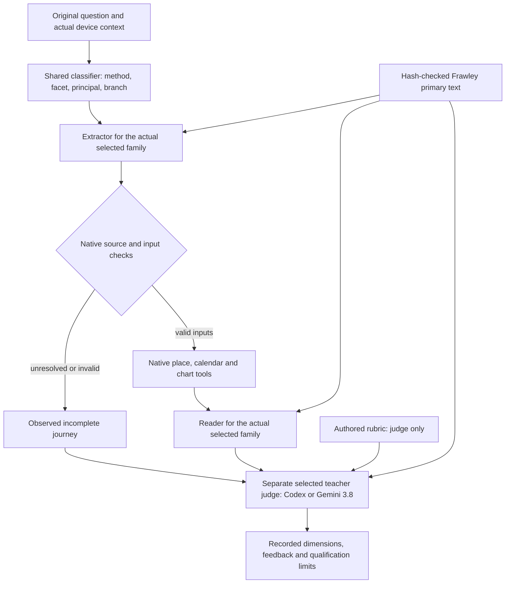

# Horary DSPy experiment

This crate uses the full [getlatentic/dsrust](https://github.com/getlatentic/dsrust/tree/f24adde08c1d8850e4d7079d019643bb40f905cb) API directly, pinned to `f24adde08c1d8850e4d7079d019643bb40f905cb` in [Cargo.toml](Cargo.toml) and [Cargo.lock](Cargo.lock). Rust derives the neural signatures; the port owns prompt rendering, parsing, demonstrations, evaluation and optimization. The local code supplies the Horary module, source context, provider transport and grading. It does not implement a replacement GEPA engine.

This is an experimental optimizer path. It has not been promoted into the production application. At the October 11 transport checkpoint, the requested Gemini 3.8 teacher returned HTTP 503 on both the legacy Google generation route and the Interactions route. The user explicitly authorized a temporary Codex teacher using the saved login; `--teacher codex` is now the default, while `--teacher gemini` retains the requested `gemini-3.8-flash` route. This is an explicit transport choice, not a silent model substitution. There is no qualified new winner from this path.

The first actual student reading received a completed Codex review with score 0.75: classification and extraction passed, while reading and answer quality failed. The feedback identified unsupported absence claims, translation/collection omissions and overclaiming from `None` or unknown evidence. Its raw answer remains intact. A validator initially mistook an exact disabled-Code-Mode startup notice for tool execution; the narrow notice check was repaired so that successful paid answer can be reused without resubmission. The repair changes neither the judgment nor the failed reading's qualification.

The complete first-message module in [journey.rs](src/journey.rs) starts with only the original question and device context. Expected method, facts, rubric and chart seeds are evaluation labels; they are not student inputs. The shared classifier selects the actual method, facet, principal and book subbranch. A wrong route remains the observed route: the runner does not substitute the expected family to reach a reader.



The extractor produces canonical facts with exact source quotes or explicitly explained contextual inferences. Native tools resolve the reader's place and question instant, retaining event place and event date as separate context. They compute the chart from those actual inputs rather than borrowing the fixture's expected chart. The reader receives native calculated evidence and primary text for the classifier's actual branch. The separate judge assesses classification, extraction, reading and answer quality against the authored rubric and family source context. A well-formed answer alone cannot pass.

The catalogue has these distinct scopes:

| Scope | Count | Role |
| --- | ---: | --- |
| Substantive reading families | 42 | Twenty complete first-message examples each: 840 case fixtures. |
| Native method labels / typed signature families | 44 | The 42 reading families plus `wish` and `unclassified` routing sentinels. Each label has an extraction and reading signature. |
| Auxiliary example banks | 60 | Twenty each for place, moment and consultation update; separate from the initial 840 cases. |
| Later and boundary banks | Separate | Missing-information, supplying, correction and genuine method-limit cases; preserved under `examples/later/`. |

Every initial family bank has 12 training, four development and four test cases, with at least eight explicit and eight implicit cases. Initial histories and missing-input labels are empty because the first message is intended to contain the necessary information. This describes fixture sufficiency, not measured reading success. `wish` with an undisclosed matter and `unclassified` cannot count as completed readings. A disclosed wish should route to its real subject. The native catalogue's implementation or expert-review status is also distinct from whether the book supplies a procedure.

[coverage.json](coverage.json) records the full taxonomy, subbranches, primary page witnesses and genuine limits. It uses [ELICITATION_DESIGN.md](../../docs/ELICITATION_DESIGN.md) for question distinctions and [READING_CONTRACTS.md](../../docs/READING_CONTRACTS.md) plus the full Frawley OCR for procedural obligations. The old report's BERT controller and canned sentence-bank design are not the executable design here. [book.rs](src/book.rs) checks the private OCR's exact SHA256 before rendering source context; [catalogue.rs](src/catalogue.rs) selects student text from the actual classified branch. The partial native passage index is not treated as the complete book. Missing native calculations, approximate positions and finite event-search coverage remain actual limits; the model must not invent later positions, stars, Parts or antiscia.

The family compiler exposes only its extractor and reader through `Module::named_predictors()`. The global classifier and independent judge stay fixed during family optimization, preventing a family run from learning an always-this-family classifier. The signatures are declared with `#[derive(dsrust::Signature)]` in [signatures.rs](src/signatures.rs); classifier, place, moment, update and judge signatures are also declared there. `optimize-classification` is a separate function experiment over all 840 cases, with 504 training, 168 development and 168 test cases. Its gate assesses classification alone; it does not claim that extraction or a reading executed. Its compiled classifier is not automatically installed into a family run or the app.

The actual optimization calls in [runner.rs](src/runner.rs) and [optimize.rs](src/optimize.rs) use the port's `Predict`, `Module`, `Evaluate`, `BootstrapFewShot` and `GEPA`:

```rust
let mut bootstrap = BootstrapFewShot::new(Graded::metric);
bootstrap.max_bootstrapped_demos = 1;
bootstrap.max_labeled_demos = 0;
bootstrap.metric_threshold = Some(1.0);
bootstrap.max_errors = 1;
bootstrap
    .compile_with_teacher(&mut program, &mut strong, &train)
    .await?;
program.save(&output.join("bootstrapped-full.json"))?;
program.compact_demos()?;

let search = GEPA::new(Graded::feedback, teacher)
    .with_max_metric_calls(max_metric_calls)
    .with_seed(23)
    .compile(&mut program, &train, &development)
    .await?;
```

BootstrapFewShot retains teacher-generated training demonstrations only when the metric reaches 1.0; no labeled gold demonstrations are added. Raw teacher responses remain in the transport artifacts, and family optimization saves complete demonstrations in `bootstrapped-full.json` before [demo.rs](src/demo.rs) projects them for teaching. The projection removes repeated primary/contract context and private grading fields. Demonstration chart evidence keeps every cited native ID and its exact detail, all planet positions, cusps, Moon-related evidence, native boundaries, anchors and tool limits. Unknown citations fail projection. This does not alter live oracle chart inputs, saved raw teacher outputs or rubric facts; omitted demonstration rows do not imply that the original chart lacked them.

Salient primary book text accompanies the actual reading and extraction inputs and the independent reviews. The family's reviewer context includes the primary chapter and every cross-chapter page declared by its question branches; a source-only invariant checks all 44 labels. GEPA also receives that primary context in feedback for its captured training minibatch, so the prompt writer has the applicable source alongside actual outputs and observed failures. Development scores select candidates; development and test words, gold and traces do not enter reflection or demonstrations. Test cases are evaluated after compilation. Do not tune another round using test findings and still call that same test bank held out.

The pinned GEPA engine checks `max_metric_calls` at iteration boundaries, so an in-flight iteration can exceed that soft limit. It is not a physical API-call cap and excludes the separate bootstrap and before/after/test evaluations. [google.rs](src/google.rs) has separate generation limits and rolling input-token pacing. The upstream GEPA adapter can assign its fallback zero when a module errors; that is not a successful independent judgment. Transport, parsing or reviewer errors still withhold a qualified comparison, and their original requests and partial traces must be retained.

The CLI accepts one family or `--method all` for both `run` and `optimize`. The all-family path processes the 42 substantive banks with shared student and teacher clients, exact-response caches, physical-call counters and one rolling student token window. Quota is not reset between families. The metric budget for family optimization is per family; global-classifier optimization has its own mixed-bank budget. From the repository root, these commands validate or inspect source without making model calls:

```sh
cargo run --manifest-path tools/horary-dspy/Cargo.toml -- \
  check --examples tools/horary-dspy/examples

cargo run --manifest-path tools/horary-dspy/Cargo.toml -- \
  inspect --method movable_deal --examples tools/horary-dspy/examples

cargo run --manifest-path tools/horary-dspy/Cargo.toml -- \
  signatures --output /absolute/path/to/signatures.json
```

`inspect` reports component-input sizes and fixture chart evidence; it does not execute or qualify a first-message journey. The separate component builder in `catalogue::example(task="reading")` deliberately uses an authored consultation for component diagnostics. `run` and `optimize` instead use `Journey::example`, whose declared student inputs are only question and device.

These commands make hosted model calls and require a new output directory:

```sh
cargo run --manifest-path tools/horary-dspy/Cargo.toml -- \
  --teacher codex run --method movable_deal \
  --examples tools/horary-dspy/examples --training-limit 1 \
  --output /absolute/path/to/fresh-transport-check --student-tokens-per-minute 14000

cargo run --manifest-path tools/horary-dspy/Cargo.toml -- \
  --teacher codex run --method all --examples tools/horary-dspy/examples \
  --output /absolute/path/to/fresh-all-family-control --student-tokens-per-minute 14000

cargo run --manifest-path tools/horary-dspy/Cargo.toml -- \
  --teacher codex optimize --method movable_deal --examples tools/horary-dspy/examples \
  --output /absolute/path/to/fresh-search --max-metric-calls 24 \
  --student-tokens-per-minute 14000

cargo run --manifest-path tools/horary-dspy/Cargo.toml -- \
  --teacher codex optimize --method all --examples tools/horary-dspy/examples \
  --output /absolute/path/to/fresh-all-family-search --max-metric-calls 24 \
  --student-tokens-per-minute 14000

cargo run --manifest-path tools/horary-dspy/Cargo.toml -- \
  --teacher codex optimize-classification --examples tools/horary-dspy/examples \
  --output /absolute/path/to/fresh-global-classifier --max-metric-calls 2048 \
  --student-tokens-per-minute 14000
```

`run --training-limit N` is a training-only transport check, not the full family evaluation; with `--method all`, it selects up to N training cases per family. `models` checks the requested Google identities even when the temporary teacher is Codex. The student always remains hosted `gemma-4-26b-a4b-it`. Select `--teacher gemini` before the subcommand to use `gemini-3.8-flash` for teaching, reflection and judging. The Google credential is read from a private file locator and is never an example, prompt or evidence artifact.

The port's `ChatAdapter::without_json_fallback()` renders and parses ordinary text. Both transports reject response schemas and tools, so typed Rust signatures do not imply constrained provider decoding. [codex.rs](src/codex.rs) invokes the existing saved login without a model override, disables tool surfaces, and checks the saved event stream for a completed tool-free turn. Its prompt treats synthetic questions, observed outputs, rubrics and book passages as data. The Gemini teacher route uses stateless Interactions with `store=false`; the student uses `generateContent`.

Completed responses can be reused by exact request identity. The Google transport permits at most three physical submissions for a logical request when it has fully received HTTP 429, 500, 502, 503 or 504, with bounded backoff. Each submission is paced, charged against the physical cap and recorded separately. Send failures, incomplete responses, parsing failures and nontransient HTTP errors are not retried; automatic protocol retries and redirects are disabled. A failed or unresolved request already present on disk is never automatically resumed. `import-codex` can copy an already successful, tool-free raw answer into a new cache after a local reporting/parser repair, preserving its original request, prompt, answer, events and exit plus their hashes; it makes no model call and does not revise the judgment. `run --cached-student-only --cached-teacher-only` disables fresh generation for both transports and fails if an exact needed response is absent. This is bounded saved-answer reuse, not a new owner/retry engine or authority to replay uncertain work.

Each run preserves a source/configuration manifest and `dataset.json`. Shared Google artifacts include `*.tokens.json`, `*.request.json`, successful `*.raw.json`, `*.response.json`, `*.receipt.json` and HTTP `*.failure.json` where those stages occurred. Physical submission artifacts use `*.attempt-N.request.json`, `*.attempt-N.body` and `*.attempt-N.result.json`, including complete-response and retry decisions. Each Codex operation preserves `request.json`, `prompt.txt`, `answer.txt`, `events.jsonl`, `stderr.log`, `exit.json` and a completed `response.json` when validated. Partial native stage observations are written before independent review; completed reviewed journeys append JSONL containing original inputs, actual stages, native failures, review and score. An all-family run writes separate family results beneath the shared output directory.

Family optimization also saves `baseline-program.json`, `baseline.json`, baseline/teacher/search observations, full and projected bootstrapped programs, `compiled.json` and the final result when execution reaches those steps. The global-classifier command saves a separate component result. Inspect these files directly while a run is active; rerunning a command is not a status query. A missing final artifact is not an empty successful result. There are no Python or frontend steps in this tool's execution path.

Source/bank review, successful execution, an independent semantic grade, a development improvement, held-out performance and production acceptance are separate claims. A compiled program is still experimental: promotion requires fresh actual application journeys, unchanged source and native guards, source-correct full readings and the application's own acceptance checks. This crate does not install a learned prompt into the app or qualify local Gemma, packaged behavior, voice delivery or unsupported native methods.
